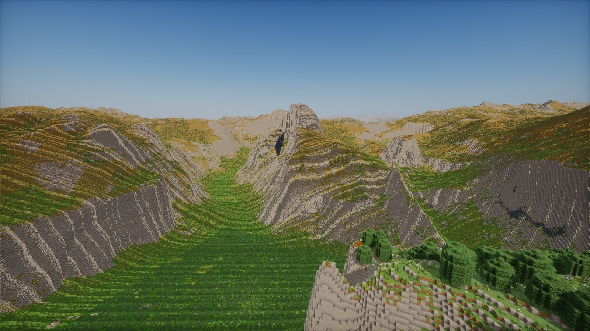
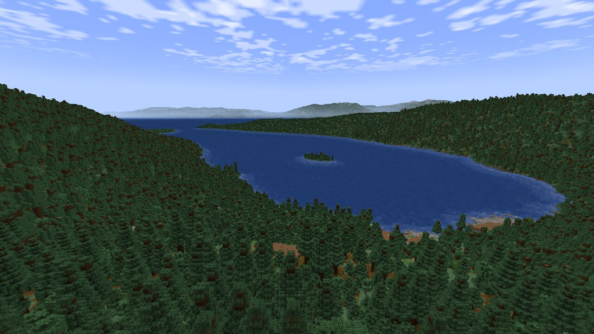
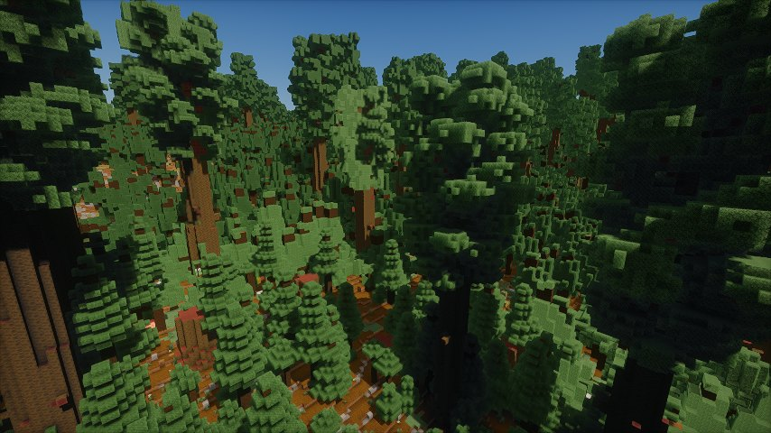
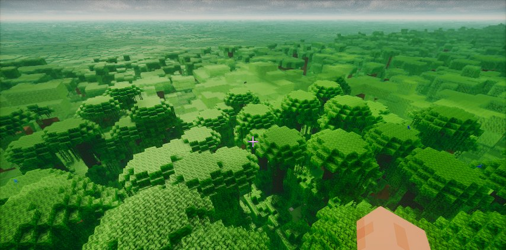
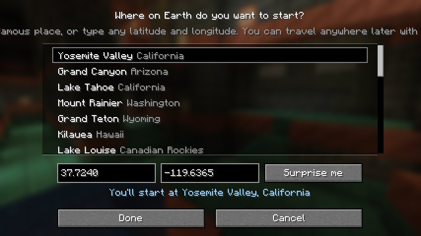

# Earth Platform

**The real Earth in Minecraft, at true scale.** One block is one metre. Every mountain stands at its real height, every lake and valley is where it really is, and the land reaches all the way to the horizon.

- **Real height, no limits.** Worlds run from Y -16384 to 16383, so Everest's summit is 8,848 blocks above the sea and you can climb it, mine it and build on it.
- **Real ground.** Elevation, land cover and climate come from open satellite and survey data. Forests, deserts, glaciers, wetlands, mangroves, lakes and rivers sit where they are on Earth.
- **Minecraft's own world, placed by the real climate.** The Amazon grows vanilla jungle, the Serengeti acacia savanna, Siberia snowy taiga. Giant sequoias stand at their real 70 to 90 m in the Sierra Nevada groves.
- **See for kilometres.** Distant terrain is drawn as textured voxels out to about 23 km, so you see the far side of the valley, not fog.
- **Ordinary survival.** Mine, craft, build and die as usual. Caves, ores, villages and other vanilla structures generate, and the Nether and the End work through normal portals.
- **Pick where to start.** Choose a famous place or any latitude and longitude when you make the world, and travel anywhere later with `/earth visit` or `/earth goto`.
- **Ride the jet stream.** Glide an elytra above Y 9,200 and the wind carries you across a continent in under an hour.
- **Plays well with others.** Create, Mekanism, Waystones, the Twilight Forest and the popular map mods work in the Earth world. See the [FAQ](docs/FAQ.md#which-other-mods-work) for the list and the [known limitations](docs/FAQ.md#known-limitations).
- **Shaders.** Tested with Iris and Photon, which light both near blocks and far terrain.
- **Servers.** Runs on a dedicated server; everyone shares the same Earth.

There are no cities: built-up land becomes the wild land around it. Vanilla villages and structures still appear.

| | |
| --- | --- |
|  |  |
|  |  |

## Get started

1. Install [NeoForge 21.1.256](https://maven.neoforged.net/releases/net/neoforged/neoforge/21.1.256/neoforge-21.1.256-installer.jar) for Minecraft 1.21.1.
2. Put the Earth Platform jar in your `mods` folder. Give the game at least 4 GB of memory.
3. Singleplayer → Create New World. The world type is already **Earth**; press **Customize** to choose where you start.

The first visit to a place downloads its terrain, so you need an internet connection. Places you have been stay on your computer and work offline afterwards.

Full steps, shaders and the Mac notes: [Install guide](docs/INSTALL.md). Commands and settings: [Playing on the Earth](docs/PLAYING.md). Problems: [FAQ and troubleshooting](docs/FAQ.md). What's new: [Changelog](CHANGELOG.md).

## Credits

The Earth comes from open data: elevation from AWS Terrain Tiles (USGS, NASA SRTM, NOAA, Copernicus and national mapping agencies), land cover from ESA WorldCover, climate from CHELSA, ecoregions from RESOLVE Ecoregions 2017, and, if you turn it on, ground colours from EOX Sentinel-2 cloudless imagery. The full attribution each source requires is in [CREDITS.md](CREDITS.md) and in game under Mods → Earth Platform.

Earth Platform changes these data to make a Minecraft world: it resamples them, picks blocks, and adds small procedural detail the data is too coarse for. It is not a survey and is not for navigation.

Distant terrain is built on ideas from [Voxy](https://modrinth.com/mod/voxy) and [Distant Horizons](https://modrinth.com/mod/distanthorizons). We'd have used them directly, but neither works with a cubic-chunks world, so we wrote our own renderer following their lead; it contains no code from either. See [CREDITS.md](CREDITS.md#distant-terrain-thank-you-voxy-and-distant-horizons).

Not an official Minecraft product. Not approved by or associated with Mojang or Microsoft.

## For developers

The source tree also holds the engine's development history and handoff notes. Start with [the source handoff](docs/handoff/SOURCE-HANDOFF.md), [ROADMAP.md](ROADMAP.md) and the [build and test guide](docs/handoff/BUILD_AND_TEST.md).

## Licence

Earth Platform is free software under the [GNU Lesser General Public License v3.0](LICENSE) (LGPL-3.0-only; it builds on the [GNU GPL v3.0](COPYING)). Modpacks may include it, and forks and ports are welcome as long as changes to its code stay open under the same licence. The Earth data keeps its own terms, listed in [CREDITS.md](CREDITS.md).
