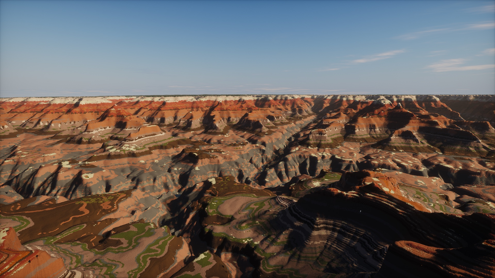
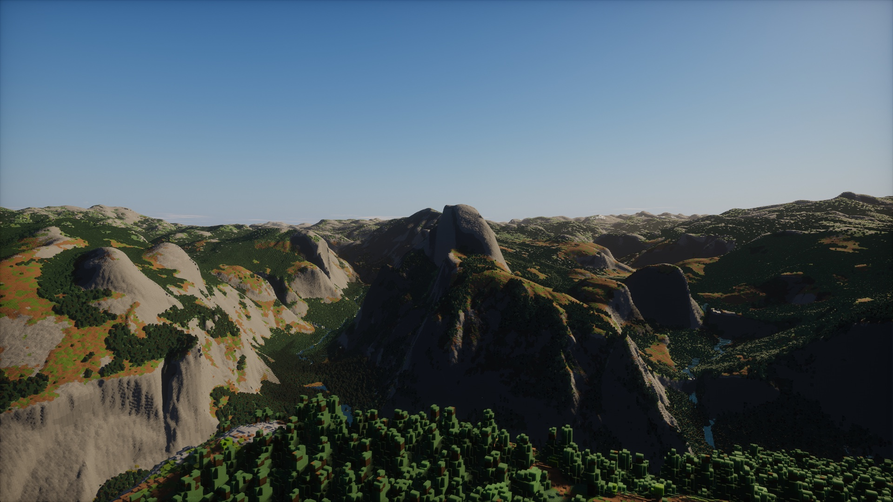
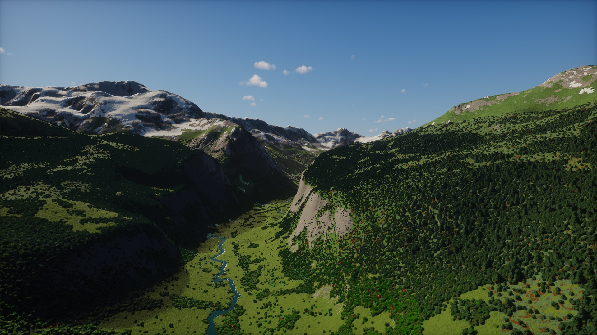
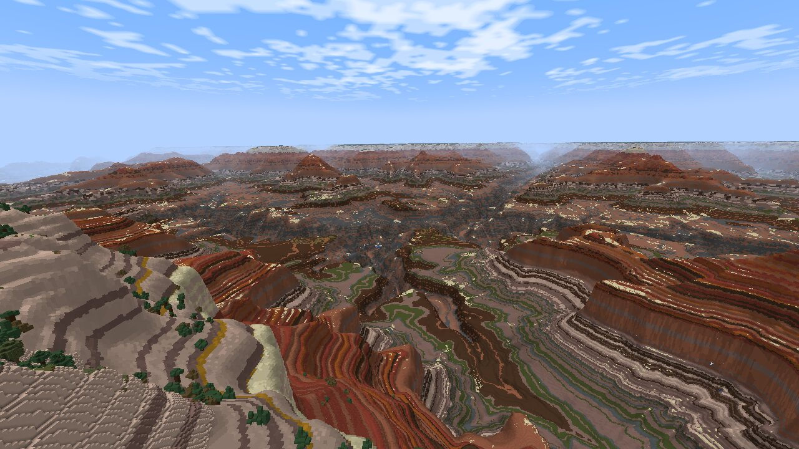
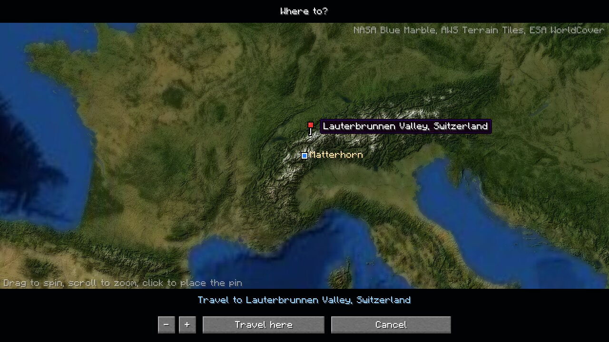
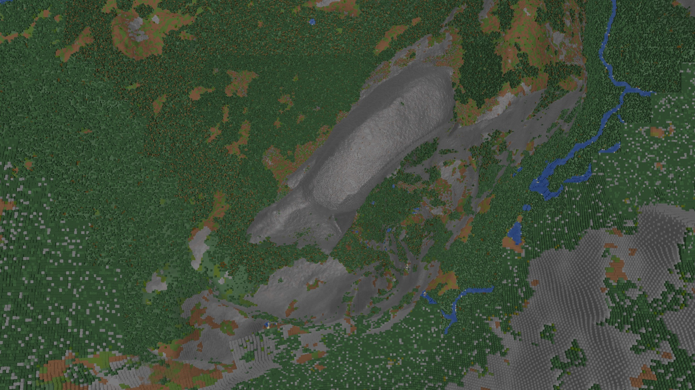
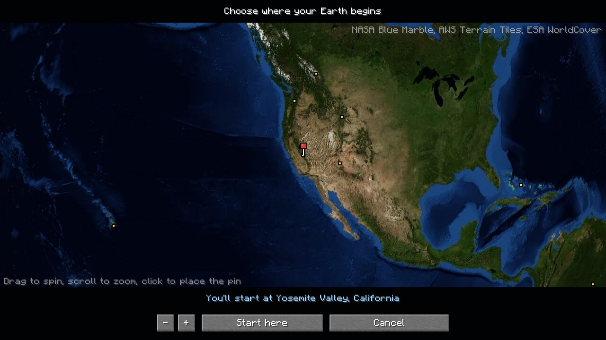
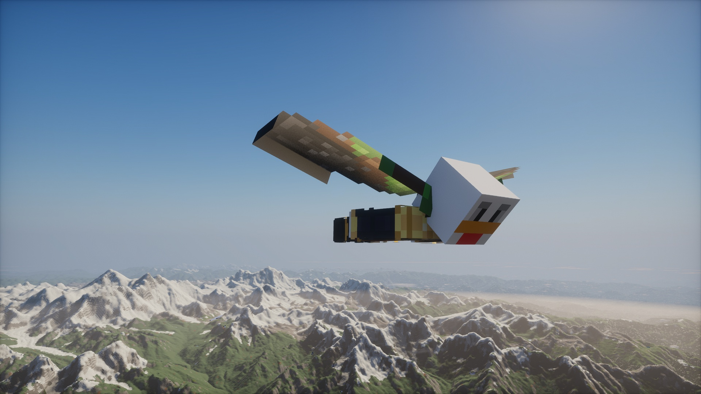
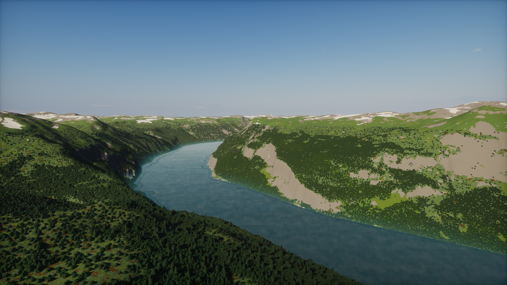

# Earth Platform

**The real Earth in Minecraft, at true scale.** One block is one meter. Every mountain stands at its real height, every lake and valley is where it really is, and the land reaches all the way to the horizon.

- **The whole planet, at real height.** Worlds run from Y -16384 to 16383, so Everest's summit is 8,848 blocks above the sea and you can climb it, mine it and build on it.
- **Real ground.** Elevation, land cover and climate come from open satellite and survey data, with the best survey for each place where one is open to all: about 10 m across the United States, lidar across much of Canada, France's 1 to 5 m national model, Japan's 5 to 10 m model and REMA in Antarctica. Forests, deserts, glaciers, wetlands, lakes and rivers sit where they are on Earth, and the Grand Canyon shows its real rock layers.
- **Minecraft's own world, placed by the real climate.** The Amazon grows vanilla jungle, the Serengeti acacia savanna, Siberia snowy taiga. Giant sequoias stand at their real 70 to 90 m in the Sierra Nevada groves.
- **See for kilometers.** Distant terrain is drawn as textured voxels out to about 94 km (58 miles), so you see the far side of the valley and the ranges beyond it, not fog. The pause menu takes it from 37 to 201 km, and extreme settings for very powerful computers reach 397 km.
- **Fly anywhere.** In creative, press **N** for the travel map: click a spot on the globe and the camera climbs out over the planet and comes back down there. In survival, **N** opens a map that points your compass at any spot, famous place or friend; use `/earth visit` and `/earth goto`, or glide an elytra above Y 9,200 and let the jet stream carry you across a continent in under an hour.
- **Ordinary survival.** Mine, craft, build and die as usual. Caves, ores, villages and other vanilla structures generate, and the Nether and the End work through normal portals.
- **Shaders.** Works with Iris and shader packs made for Voxy, such as the stock Photon download, which light near blocks and far terrain alike, Macs included.
- **Servers and other mods.** Runs on a dedicated server where everyone shares the same Earth. Create, Mekanism, Waystones, the Twilight Forest, Replay Mod and the popular map mods work in the Earth world; see the [FAQ](docs/FAQ.md#which-other-mods-work).

There are no cities: built-up land becomes the wild land around it. Vanilla villages and structures still appear.

| | |
| --- | --- |
|  |  |
|  |  |
|  |  |
|  |  |
|  |  |

## Get started

1. Install [NeoForge 21.1.259](https://maven.neoforged.net/releases/net/neoforged/neoforge/21.1.259/neoforge-21.1.259-installer.jar) (any 21.1.256 or newer works) for Minecraft 1.21.1.
2. Download the newest Earth Platform jar from [Releases](https://github.com/pirut/earth-platform/releases/latest) and put it in your `mods` folder. Give the game at least 4 GB of memory, or at least 6 GB with shaders such as Photon.
3. Singleplayer → Create New World. The world type is already **Earth**; press **Customize** to choose where you start from a list of famous places, a globe, or any latitude and longitude.

The first visit to a place downloads its terrain, so you need an internet connection. Places you have been stay on your computer (up to 8 GB by default) and work offline afterwards.

More: [Install guide](docs/INSTALL.md) (shaders, Macs, servers) · [Playing on the Earth](docs/PLAYING.md) (commands and settings) · [FAQ and troubleshooting](docs/FAQ.md) · [Changelog](CHANGELOG.md)

## Credits

**Earth Platform would not be possible without open data.** Every mountain, coastline, forest and river in the game comes from data that scientists, space agencies and mapping agencies collected over many years and chose to share. Thank you to every one of them.

| Data | What it gives the game | From | License |
| --- | --- | --- | --- |
| [AWS Terrain Tiles](https://registry.opendata.aws/terrain-tiles/) | The shape of the whole planet, land and sea floor | Mapzen/Tilezen, built from USGS, NASA SRTM, NOAA, Copernicus and national mapping agencies | Per source, see [CREDITS.md](CREDITS.md#elevation-aws-terrain-tiles) |
| [Copernicus DEM GLO-30](https://spacedata.copernicus.eu/collections/copernicus-digital-elevation-model) | Steep fjords and the far north | European Union, ESA, DLR and Airbus | Copernicus WorldDEM-30 license |
| [USGS 3DEP](https://www.usgs.gov/3d-elevation-program) | Detailed heights across the United States | U.S. Geological Survey | Public domain |
| [REMA](https://www.pgc.umn.edu/data/rema/) | Antarctica's ice and mountains | Polar Geospatial Center, University of Minnesota | CC BY 4.0 |
| [HRDEM](https://open.canada.ca/data/en/dataset/957782bf-847c-4644-a757-e383c0057995) | Lidar ground across much of Canada | Natural Resources Canada | Open Government Licence - Canada |
| [RGE ALTI](https://geoservices.ign.fr/rgealti) | Detailed heights across France | IGN, France | Licence Ouverte / Etalab 2.0 |
| [GSI elevation tiles](https://maps.gsi.go.jp/development/ichiran.html) | Detailed heights across Japan | Geospatial Information Authority of Japan | Public Data License 1.0 |
| [ESA WorldCover](https://esa-worldcover.org/) | Where forests, grass, desert, snow, wetlands and water lie | European Space Agency and the WorldCover consortium | CC BY 4.0 |
| [CHELSA](https://chelsa-climate.org/) | The real climate, which picks every biome | Karger et al., WSL | CC0 1.0 |
| [JRC Global Surface Water](https://global-surface-water.appspot.com/) | Rivers and streams carved where water flows | European Commission JRC, Google, Copernicus | Free, without restriction |
| [RESOLVE Ecoregions 2017](https://ecoregions.appspot.com/) | Each region's character, such as swamps and mangroves | RESOLVE, Dinerstein et al. | CC BY 4.0 |
| [NASA Blue Marble](https://visibleearth.nasa.gov/collection/1484/blue-marble) | The globe on the start and travel maps | NASA Earth Observatory, Reto Stöckli | Public domain |
| [Sentinel-2 cloudless](https://cloudless.eox.at) (optional, off by default) | Ground colors that match the view from space | EOX IT Services | See [CREDITS.md](CREDITS.md#ground-colours-optional-sentinel-2-cloudless) |

The full attribution each source asks for, and how we changed its data, is in [CREDITS.md](CREDITS.md) and in game under Mods → Earth Platform. Earth Platform resamples these data, picks blocks and adds small procedural detail the data is too coarse for, so it is not a survey and is not for navigation.

**Distant terrain: thank you, Voxy and Distant Horizons.** Our far terrain is built on ideas from [Voxy](https://modrinth.com/mod/voxy) by Cortex and [Distant Horizons](https://modrinth.com/mod/distanthorizons) by James Seibel and contributors. We'd have recommended using them directly, but neither works with a cubic-chunks world, so we wrote our own renderer following their lead; it contains no code from either. See [what we learned from each](CREDITS.md#distant-terrain-thank-you-voxy-and-distant-horizons).

Not an official Minecraft product. Not approved by or associated with Mojang or Microsoft.

## Building from source

See [Building and testing](docs/BUILDING.md). [ROADMAP.md](ROADMAP.md) describes how the engine works and what comes next.

## License

Earth Platform is free software under the [GNU Lesser General Public License v3.0](LICENSE) (LGPL-3.0-only; it builds on the [GNU GPL v3.0](COPYING)). Modpacks may include it, and forks and ports are welcome as long as changes to its code stay open under the same license. The Earth data keeps its own terms, listed in [CREDITS.md](CREDITS.md).
