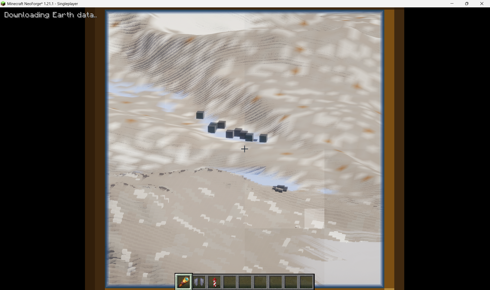
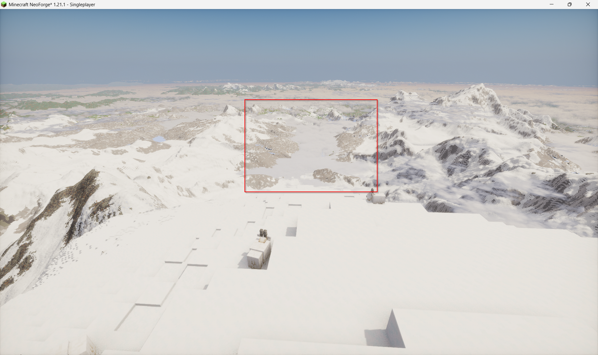

# Flight and distant-rendering prototype: maintainer review

This branch contains the accumulated local test changes made after Build 69
(`59fdd45`). It is a **prototype for review**, with unresolved player-reported
artifacts and performance problems. Please assess, split, adapt or discard the
individual changes before publishing. No measured in-game FPS improvement or
complete fix for the issues below is claimed.

Upstream `main` was at `1d3208decfb433f084957b763504fa2b17982661`
(Build 70 roadmap) when the contribution was prepared on November 11, 2026,
57 commits ahead of this prototype's base. This branch preserves the tested
Build 69 implementation; it has not been integrated with or validated against
Build 70. Overlapping renderer and generator changes need maintainer review.

## Outstanding issues reported during play

| Priority | Report and reproduction | Status / limits of the attempted correction |
| --- | --- | --- |
| High | **Isolated oversized dark cubes in distant mountain terrain.** Stand on Mount Everest (`/earth visit everest`, summit near 27.9881 N, 86.9250 E) and inspect the surrounding glacial valleys with a spyglass. The user reports the cubes with shaders disabled as well. | **Unresolved.** Real-scale textures and folding coarse vegetation into the smooth surface did not remove the reported cubes. Do not describe this branch as fixing them. The exact camera direction at the artifact remains needed. |
| High | **Cloud clipping / incorrect overlap with mountains.** White patches and cloud boundaries appear to cut into distant mountain views. Earlier reports also showed grid-like fractures, thin straight upper-cloud ribbons, and a near-white screen around Y 3400–4200 without shaders. | Depth-stable cloud sampling, accurate far-depth clipping and a grazing-angle fade were added to the plain renderer. Automated fixtures pass, but the latest cloud screenshot was taken with Photon enabled. The mod disables its custom cloud pass in that mode; Photon needs a separate runtime investigation. The user suggested the latest cloud problem may be shader-related, but that was not conclusively verified. |
| High | **Spyglass performance regression.** Zooming into distant terrain becomes very slow at settings above Fast Far, even when the unzoomed view is acceptable. | Zoom refinement/requests and replan frequency were bounded. This is an attempted mitigation; no repeatable before/after game FPS or frame-time capture establishes the remaining cost. |
| High | **Stutter / major slowdown when interactable 16x16x16 cubes load.** Approaching the surface triggers a sharp performance loss. | Snapshot reuse, bounded snapshot/upload work, shorter worker queues and a guarded buried-stone shortcut were added. These have correctness tests, not a demonstrated end-to-end performance result in a 100+ player server or full game. |
| Medium | **Distant terrain striping, rough steps, obvious smoothing patches and LOD transitions.** This is particularly visible through a spyglass, and some shader views had lines resembling shadow bands. | Coarse connected surfaces, texture footprint filtering, slope lighting and conservative default far-shadow settings were adjusted. Levels 1–4 retain block faces. Transitions and interaction with shader screen-space effects still require visual review. |
| Medium | **Horizon grids / fractures near the simulated rounded horizon.** Ocean/cloud views made the seams especially obvious through a spyglass. | A common radial water warp, bounded ocean tessellation and more precise depth were added. A controlled GPU ocean-seam fixture improved, but that is not proof that every reported runtime fracture is gone. |
| Medium | **Distant water looks transparent enough to expose the seabed.** The report occurred with shaders and also without them. | Coarse water alpha is raised and depth handling was changed. Water/shore transitions and shader optics remain runtime checks. |

The user's visual requirements are to preserve recognisable Minecraft blocks
nearby, keep useful distant detail while flying or zooming, and provide a more
immersive high-altitude sky with different cloud heights and clear/cloudy periods
around peaks. A No Man's Sky-like travel view was an inspiration, not an implemented
replacement planet renderer. This prototype still draws distant terrain; it does
not replace the world with a fully spherical atmosphere or guarantee zero chunks
at flight altitude.

## Implementation map

* **Surface streaming:** `SurfaceFlight`, `ServerCubeWorld` and surface-bound
  generator APIs retain relevant surface cubes within the existing work/network
  budgets when airborne, release unnecessary buried buffers, and keep the
  collision/descent band. See [FLIGHT-RENDERING.md](FLIGHT-RENDERING.md).
* **Nearby meshing:** `CubeWorkBudget`, `CubeSnapshotCache`, `CubeInterior` and
  `CubeRenderer` bound render-thread work, reuse immutable state snapshots, reject
  stale uploads and conservatively skip fully enclosed stone/deepslate meshes.
  See [NEAR-CUBE-PREVIEW.md](NEAR-CUBE-PREVIEW.md) and
  [SNAPSHOT-REUSE-PREVIEW.md](SNAPSHOT-REUSE-PREVIEW.md).
* **Distant terrain / zoom:** `FarMesher`, `FarColumnMesh`, `FarSmoothGround`,
  `FarShaders`, `FarZoom` and `FarRequestOrder` change coarse materials and
  surfaces, keep detailed levels blocky, and limit zoom work. See
  [DISTANT-BLOCKS-PREVIEW.md](DISTANT-BLOCKS-PREVIEW.md),
  [BLOCKY-NEAR-PREVIEW.md](BLOCKY-NEAR-PREVIEW.md) and
  [SPYGLASS-PREVIEW.md](SPYGLASS-PREVIEW.md).
* **Depth, water and horizon:** `FarPlainDepth`, `FarWaterShader`, `EarthView`
  and renderer plumbing introduce a precise plain-renderer depth pass and
  camera-relative visual curvature. The custom curvature is disabled with
  shader packs. See [HORIZON-SEAMS.md](HORIZON-SEAMS.md).
* **Plain-renderer sky:** `EarthClouds`, `CloudVolume`, `CloudField`,
  `CloudWeather` and private shader resources implement three lit cloud bands,
  local extinction, scene-depth clipping and slowly varying regional weather.
  Shader packs keep their own clouds. See [CLOUD-VOLUME-PREVIEW.md](CLOUD-VOLUME-PREVIEW.md)
  and [MOUNTAIN-WEATHER-PREVIEW.md](MOUNTAIN-WEATHER-PREVIEW.md).
* **Optional new-world floor:** `WorldDepth` pins a default floor 12,000 blocks
  below sea level (Y -11937) or the original Y -16384 extended depth. Existing
  worlds keep their pinned/original depth. Cave and ore rules above the floor
  were not redesigned. This is a generation-depth limit, not a measured file-size
  or server-performance guarantee. See [WORLD-DEPTH.md](WORLD-DEPTH.md).
* **Optional Photon presets:** `scripts/New-PhotonEarthPresets.ps1` validates
  and generates settings for **unmodified Photon v1.3b** only. No shader pack is
  bundled or patched by that script. The player's later instance used **Photon
  v1.4**, which is outside that preset's validation. See
  [PHOTON-EARTH-PRESET.txt](PHOTON-EARTH-PRESET.txt).

Elytra/firework restrictions were not changed by this contribution; the existing
jet-stream rules remain upstream behaviour.

## Evidence and release limits

The verification command and exact pinned Iris/Sodium/Photon build inputs are
described in [BUILDING.md](BUILDING.md). Opt-in invisible-window GPU checks use
`EARTH_GL_TESTS=1`. A fresh `verifyShimArtifact` run on November 11, 2026
completed with **265 tests: 259 passed, six skipped, no failures/errors**.
The skips are five optional benchmarks and the private-input Everest probe.
All seven real-driver GPU tests ran. The shader build contract and artifact
exclusion check passed. The Photon preset generator separately validated all
66 options in each v1.3b preset without changing the source shader ZIP.

The snapshot reuse fixture performs 125 copies for 729 neighbourhood requests
instead of 729 fresh copies. That is a synthetic allocation/copy reduction,
**not an 83% FPS improvement**. Queue/time budgets bound routine work but an
individual indivisible operation can exceed its allowance.

`EverestRenderProbeTest` and `EverestProbeImage` provide an opt-in investigation
using copied inputs, described in [EVEREST-RENDER-INVESTIGATION.md](EVEREST-RENDER-INVESTIGATION.md).
The sampled clean glacier columns and copied edited columns did not reproduce
the isolated cubes. The saved entities contained no falling-block entities.
This does not rule out a streaming/selection, material, depth, handoff or other
runtime problem in the actual reported view.

## Player screenshots of the remaining issues

These are the supplied in-game bug-report screenshots, not results produced by
the offline probe. Photon was enabled in these captures. The player separately
reported the isolated cubes with shaders disabled; a matching shader-off capture
was not supplied. The download indicator is visible in the spyglass capture, so
the effect of incomplete streaming versus a settled view remains to be checked.

No full game visual acceptance, reproducible game FPS benchmark, 100+ player
load test, Fabric build, or Build 70 integration verification has been completed
for this submitted snapshot. Private worlds, entity-region files, terrain caches,
logs, local camera records, generated test images, downloaded upstream binaries
and local test JARs are excluded from the contribution.
